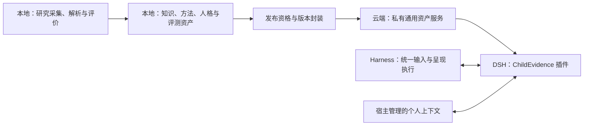

# ChildEvidence

> 以经典和持续更新的儿童教育学、儿童心理学研究为基础，生产可追溯的专业能力资产，通过 Harness 插件提供融合教师、教练与一般心理支持视角的儿童成长支持。
> 自 LumiThink Research Library v0.1 独立拆分而来（见 [MIGRATION.md](MIGRATION.md)）。

## 项目定位

ChildEvidence 的目标是让更多儿童获得持续学习、相互协调的专业团队式支持：帮助理解学习困难、尝试改善方法、探索兴趣与发展优势。服务对象可为儿童、家长或教师；系统通过长期互动积累观察，不要求家长预先完成兴趣或能力分析。

- **插件交付，DSH 首发**：交付工具、运行流程和专业资产，不仅是一组角色提示词。科研生产可适配 Codex、DSH、Claude Code；生产与消费 Harness 不必相同。
- **本地生产＋云端专业资产服务**：研究知识、教育判断、支持与复盘方法、互动人格及表达规范都从本地科研生产形成并按版本发布。
- **统一输入输出**：Harness 处理语音、文字、作业照片和 Web 互动；插件消费统一情境，返回结构化支持结果，由 Harness 呈现与执行。
- **个人记录留在宿主**：ChildEvidence 定义成长记录的专业语义，宿主管理身份、授权、存储、纠正和删除。科研库及云端通用服务不接收儿童档案。
- **首阶段低风险**：聚焦日常学习、教育及一般情绪支持，不包括诊断、治疗、高风险干预或天赋/智力定性。
- **保留独立科研基础设施**：复用 Python/SQLite、采集与解析；项目不依赖 LumiThink 的业务代码、用户系统或部署环境。下游只能按版本消费发布资产，不直接读写科研库。

## 当前状态与下一阶段入口

截至 2026-10-17，源码基线为 `57b309e`。以下区分工程实现与科研/产品验收，不能根据 Issue 关闭或 PR 合并推定功能已投入使用。

| 能力 | 当前状态 |
|---|---|
| 文献采集、核验、去重、开放 PDF 获取、编目与导出 | 已实现，SQLite 为科研文献事实源 |
| CE-01R | 四份规程仍为 DRAFT v1.1；#1 关闭不等于已签署生效 |
| CE-02 | 盲法工具已实现；80 篇人工审核未据此验收，#2 仍开放 |
| CE-03 | 解析已实现；历史 10 份 E2E 为 9 ok / 1 degraded，定位准确率未验证 |
| AI Reviewer 与模型权限登记 | 已实现生产侧工具；`POLICY_ACTIVE=False`，不是儿童交互插件 |
| 真实首篇科研审查 | [#10](https://github.com/lybym/ChildEvidence/issues/10) 尚未闭环，需满足授权、输入与模型身份条件 |
| Evidence/Claim、方法/人格资产、发布器、DSH 插件和云端查询 | 规划中，未部署 |

最近一次既有工程回归为 **237 项测试通过＋离线冒烟通过**。历史文档中的 44/185/231 项是各自交付时点的数量；工程测试不证明科研结论、插件专业行为或教育效果成立。

- [产品与 MVP 设计](docs/design/growth-support-mvp/README.md)
- [目标架构与技术比较](docs/design/growth-support-mvp/architecture.md)
- [专业资产、统一接口与成长记录](docs/design/growth-support-mvp/contracts.md)
- [两次互动的完整合成样例](docs/design/growth-support-mvp/walkthrough.md)
- [验收与分阶段路线](docs/design/growth-support-mvp/delivery-plan.md)
- [Issue 执行索引](docs/roadmap/growth-support-issues.md)
- [治理衔接清单](docs/governance/GROWTH-SUPPORT-TRANSITION.md)及[文档导航](docs/README.md)

目标架构（规划中）：



推荐以结构化专业资产、可执行流程和 DSH 现有模型建立基线，再通过评测决定语义检索或小模型的收益。Python 生产＋TypeScript 插件核心是待验证建议，尚未引入依赖。新论文不直接修改运行中的人格或教育行为；审核发布资格仍需专门决策。

## 研究范围

| 领域 | 代码 |
|---|---|
| 儿童发展心理学（皮亚杰/维果茨基/埃里克森/鲍尔比/布朗芬布伦纳/班杜拉、执行功能、社会性与情绪发展、神经多样性） | `child_development` |
| 教育心理学与学习科学（SDT、SRL、元认知、成长型思维、认知负荷、提取/间隔/交错练习、阅读与数学困难、反馈与脚手架） | `learning_sciences` |
| 儿童行为与心理支持（共同调节、挫折耐受、学习焦虑与回避、亲子冲突、正向行为支持、睡眠、SEL、转介边界） | `behavior_support` |
| AI 儿童陪伴与数字心理学（2023–2026 重点） | `ai_children` |
| 中国儿童与家庭教育（中文文献独立收录，CFPS/CEPS 实证研究） | `china_family` |

同时维护经典与新近研究，覆盖论文、机构报告、调查研究、综述等；不把新近或高引用等同于高质量。范围与分级提案见 [RESEARCH_METHODOLOGY.md](RESEARCH_METHODOLOGY.md)（DRAFT 未生效）；[分类快照](docs/research/research-taxonomy.md)是生成参考，不是不可变规范。

## 项目架构

```
ChildEvidence/
├── README.md / AGENTS.md / MIGRATION.md
├── pyproject.toml            # 元数据与打包定义（纯标准库，无第三方依赖）
├── src/research_library/     # 流水线包（discovery/verify/acquisition/export/reports/CLI）
├── config/                   # sources.yaml / topics.yaml / seed-papers.yaml
├── tests/                    # 单元测试（本地模拟 HTTP 服务器，离线）
├── scripts/                  # smoke_real.py（联网冒烟）、smoke_offline.py（离线冒烟）
├── docs/design/              # 成长支持产品与架构草案
├── docs/roadmap/             # Issue-first 执行索引
├── docs/research/            # 数据库生成参考，不手改
├── exports/                  # 科研导出，不等同可发布知识包
└── data/research-library/    # library.sqlite + pdf/ + cache/ + logs/（gitignored）
```

## 安装（Windows PowerShell）

核心要求 Python 3.11+，默认运行时为标准库；PDF 解析使用单独的可选依赖。

```powershell
cd C:\CODE\ChildEvidence
$env:PYTHONPATH = "src"
python -m research_library status
```

按官方来源需要直接设置环境变量
（`CHILDEVIDENCE_CONTACT_EMAIL`、`UNPAYWALL_EMAIL`、`CROSSREF_MAILTO`、`OPENALEX_API_KEY`）。
凭据不入 Git；各来源的认证要求以实际配置与官方接口为准。

当前优先使用源码方式运行。独立 wheel 安装的配置/契约资源完整性仍需修复验收，不能从源码运行通过推定安装包已独立可用。`status` 使用会初始化 schema/WAL 的连接函数，不是严格只读审计命令。

## 数据目录

默认 `\<项目根>\data\research-library\`，可用环境变量覆盖（优先级从高到低）：

1. `--data-dir` 命令行参数
2. `CHILDEVIDENCE_DATA_DIR`
3. `RESEARCH_LIBRARY_DATA_DIR`（旧别名）
4. 项目内默认路径

路径解析基于 `pathlib` 与模块文件位置，**不依赖当前工作目录**，也不依赖任何外部项目。

按工作区规范，新持久数据应放在仓库外的 `ChildEvidence-data/`，一次性实验放到 `_scratch/ChildEvidence/`。设置新目录不会自动迁移旧库；迁移须另做备份、校验与路径转换，本轮不迁移数据。

## CLI 使用

```powershell
$env:PYTHONPATH = "src"
python -m research_library discover    # 种子+主题检索+引用扩展+择优入库（联网）
python -m research_library verify      # Crossref 元数据核验 + OpenAlex 回填（联网，幂等）
python -m research_library acquire     # 下载合法开放 PDF 并校验（联网，幂等）
python -m research_library verify-pdfs # 校验本地 PDF（离线）
python -m research_library export      # exports/works.csv|jsonl|bib（离线）
python -m research_library docs        # 重新生成 docs/research/*.md（离线）
python -m research_library status      # 当前库状态（离线）
python -m research_library import-pdf <pdf路径> --doi 10.xxxx/yyyy  # 人工 PDF 导入（离线）

python -m unittest discover -s tests -v   # 单元测试
python scripts\smoke_offline.py           # 离线端到端冒烟
python scripts\smoke_real.py              # 联网端到端冒烟（少量真实请求）
```

增量更新：所有命令幂等，已核验/已下载条目自动跳过；删除 `data/research-library/cache/`
可强制重拉 API。

现有导出可能包含摘要、`raw_sources` 和本机路径，不得直接当成云端发行包。发布器须使用字段白名单并单独验证资料授权。

## 人工盲法复核（CE-02）

A2 80 篇文献相关性复核的**离线人工标注流水线**（`review` 子命令），实现依据
DRAFT v1.1 规程（ANNOTATION_GUIDE 等，未经人工批准不生效）。要点：

- 独立标注库 `data/review/annotations.sqlite`，与主事实源 `library.sqlite` 零读写关联；
- 只读导入盲法 CSV，携带历史标签/抽样层/模型排名或预填判定的输入被拒绝；
- 人工判定追加式留痕（理由码必填，undecided 合法，单人标注封顶 provisional）；
- 唯一 Gold 通道 = 独立复核一致或裁决完成 + 人工签署（`record-signoff`）；
- 解盲审计的硬前置：全部标签锁定；审计只读 join 带键表，原决策不覆盖。

完整流程、schema 与边界见
[docs/review/CE-02-ANNOTATION-PLAN.md](docs/review/CE-02-ANNOTATION-PLAN.md)。

## 受控 PDF 解析（CE-03，可选依赖）

`parse` 子命令提供 **Docling 优先 + pdfplumber 回退** 的受控解析流水线
（数据加工层；不生成 Claim/Evidence 语义，不触碰知识包与 Agent 策略）。
**默认 CLI 保持零第三方依赖**——只有显式运行 `parse` 时才在隔离 venv 内懒加载
docling/pdfplumber（引入理由：POC-B 实测 Docling 2.138.0 为唯一同时满足
结构化+页码/坐标溯源+中英可靠的解析器；见
[docs/assessment/2026-10-13-poc-tech-evaluation/FINAL_RECOMMENDATION.md](docs/assessment/2026-10-13-poc-tech-evaluation/FINAL_RECOMMENDATION.md) §9）。

```powershell
# 一次性：隔离 venv 安装可选依赖（不影响零依赖采集环境）
python -m venv C:\path\to\ce03-venv
C:\path\to\ce03-venv\Scripts\python.exe -m pip install ".[parsing]"
# 一次性：下载 Docling 运行权重到本地缓存（唯一联网步骤；需显式授权执行）
C:\path\to\ce03-venv\Scripts\python.exe -m research_library parse models --artifacts-dir C:\path\to\model-cache
# 日常：离线解析（产物版本化、幂等、断点续跑）
C:\path\to\ce03-venv\Scripts\python.exe -m research_library parse run --manifest <manifest.json>
C:\path\to\ce03-venv\Scripts\python.exe -m research_library parse report --format md --out report.md
```

要点：物理页/印刷页严格分离（印刷页只由人工校正文件写入，永不推断）；
bbox 只代表"坐标存在"而非"定位正确"（存在率与准确率分开报告，准确率留给
CE-04 人工 Gold）；失败回退显式标记 `fallback`；双解析冲突生成复核任务不自动裁决；
解析产物写入 `data/research-library/parse-output/`（gitignored），
`library.sqlite` 零写入。完整说明与边界见 [docs/parsing/README.md](docs/parsing/README.md)。

## PDF 获取与人工导入

自动下载仅尝试官方 API 标注的开放获取位置（Europe PMC 全文库、OpenAlex OA、Unpaywall、
Crossref 全文链接、ERIC、机构官网），并逐项校验：HTTP 状态 → Content-Type（拒绝 HTML）→
`%PDF-` 头 → 体积 → `%%EOF` → 页数扫描 → SHA-256 → 跨条目重复检测。
需机构订阅的文献进入 `docs/research/manual-download-queue.md`，人工下载后用
`import-pdf --doi` 导入，自动匹配去重，不产生重复条目。

## 版权边界

1. 开放获取 ≠ 可自由再分发；许可证逐条记录，未知记 `license_unknown`。
2. PDF 原文仅保存在本地 `data/`（已 gitignore），不提交公共仓库。
3. 不绕过任何付费墙、验证码或访问控制；付费文献仅保存书目与官方入口。
4. 预印本独立标记，不等同正式发表。

## 手动 AI 科研审查 Skill

显式调用 `$child-evidence-reviewer` 对指定文献/草稿执行 screen、appraise、extract、
challenge 或 audit。Skill 位于 `.agents/skills/child-evidence-reviewer/`，
`allow_implicit_invocation=false`；使用当前 Codex 会话并如实记录模型身份，不能自动
切换为 Astra。它只读输入，输出独立 silver/L0 提案到
`data/review/ai-review/<run_id>/`；不改科研库、人类标注、Gold 或发布门禁。

先用本地标准库工具做许可/政策预检，再决定模型可读范围。现行摘要/PDF出站禁令
同样约束 Docling/审核草稿衍生内容；本地读文件不代表模型离线。无 API 客户端、
API Key 依赖、常驻服务或批量调度。使用方法、Schema/哈希说明、离线测试和风险
见 [Skill 使用说明](.agents/skills/child-evidence-reviewer/references/usage.md)。
工程验证与少量真实来源拒绝演示见
[AI Skill 验证记录](docs/review/AI-SKILL-VALIDATION.md)。
来源 Work 身份与 scope 严格绑定；模型引用须同时获准且声明实际入模型，
包括两个 Pass 原始结果，blocked 状态也不豁免。Skill 交付时回归为231项（46项Skill测试）；当前基线见上文状态表。

四份科研规程保持 DRAFT v1.1 未签署。实机发现已验证，科研模型审查尚未运行；
本次少量真实来源演示只验证本地预检/结构与拒绝边界，不宣称 Astra 正确率。

## Issue-first 路线

1. 明确 AI 科研审核、首包资格与人格演进规则；完成必要的授权与最小包接入，接续现有 #10。
2. 建立 Evidence/Claim、方法、人格及评测资产，完成独立可发布的最小版本包。
3. 以合成数据验证 DSH 原生插件的统一接口、受控入口、运行核心与宿主成长记录。
4. 形成云端私有资产服务和端到端行为评测；真实发布资格满足后开展有边界的私人试用。
5. 根据实际失败类型与成本，评估语义检索、小模型、其他 Harness 和最后的 LumiThink 集成。

正式包保留 `catalog.jsonl`、`evidence-cards.jsonl`、`strategies.jsonl`、`manifest.json`，按契约增加方法、人格与评测资产。个人记录不进入包，Schema/包/插件版本分别管理；回滚不能恢复已撤回内容。

具体依赖和实际编号见 [Issue 执行索引](docs/roadmap/growth-support-issues.md)。文档与研发授权不等于规程生效、原文外发或真实使用批准；本次不自动打开任何门禁。
