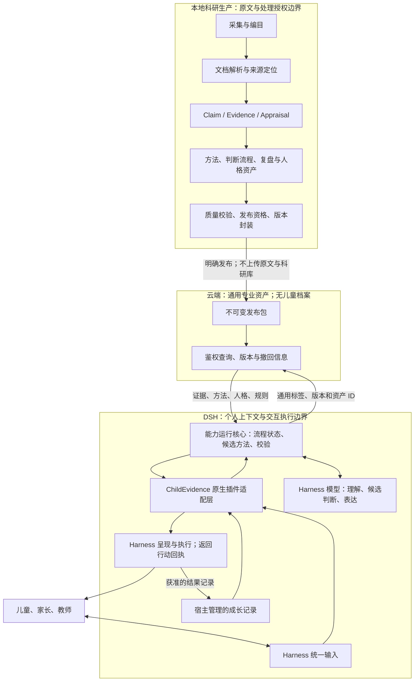

# 目标架构与技术决策

> DRAFT v0.2，2026-10-17。以下除明确引用的现状和用户确认方向外均为技术建议；不新增运行能力或依赖。产品范围见 [入口](README.md)，实施依赖见 [Issue 索引](../../roadmap/growth-support-issues.md)。

## 1. 推荐架构

保留 Python/SQLite 科研单体，增加结构化专业资产生产与版本发布；云端只提供已发布通用资产；DSH 原生插件在宿主边界内应用这些资产。采用一个连贯角色组合多种专业视角，不预设多 Agent 团队。

图中模型推理是逻辑协作，不表示插件另建付费模型服务。MVP 优先复用 DSH 当前模型；科研生产的模型授权与儿童交互的模型数据路径分别管理。云端通用查询不接收自由文本会话、个人 ID、题目照片或完整作业。

## 2. 领域职责与实现归属

| 模块 | 负责 | 不负责 | 实现建议 |
|---|---|---|---|
| Catalog | 稳定 Work 身份、版本、来源类型、采集历史 | 科研结论与个人档案 | 复用现有 Python/SQLite；保留 `lt-` ID，不因品牌改名 |
| Source/Parsing | 来源文件版本、解析版本、页/段定位与质量标记 | 证据强度、行动建议 | 复用 CE-03；将内容哈希与定位校正版本补齐 |
| Research | RQ、Claim、Finding、证据关系、方法学评价与不确定性 | 自动证明个体适用性 | 增量扩展数据模型，迁移与兼容测试独立交付 |
| Capability authoring | 综合为策略、观察方法、判断/复盘流程、人格规范、评测案例 | 真实儿童个体推断 | Python 生产与验证；AI 生成草稿但不伪造来源或审批 |
| Publisher | 权限、资格、引用闭包、哈希、兼容性、发布和撤回 | AI 科研审查、儿童服务 | 从白名单构建发布包，禁止直接复用全字段 `export` |
| Query | 筛选、读取、证据追溯、版本状态 | 临床决策、个人记录 | 薄 HTTP 服务，读取包生成的索引；部署技术选型待实施决策 |
| Capability runtime | 统一输入校验、状态迁移、方法候选、提案校验、结果记录提案 | ASR/OCR/UI、无条件判断模型内容为真 | 单一可移植 TypeScript 核心，优先与 DSH 插件同进程；不再强制安装 Python 生产环境 |
| DSH adapter | 工具注册、上下文映射、宿主身份绑定、取消/超时、输出转换 | 重写科研规则和方法内容 | 薄 Cordis 插件；规则/方法从发布资产加载 |
| Host storage/UI | 身份、访问权、个人记录、媒体处理、Web 活动与实际行动回执 | 向上游修改证据等级 | 宿主负责物理存储；ChildEvidence 定义记录语义及候选变更契约 |

TypeScript 运行核心是建议，尚未创建模块或引入依赖。Python 负责科研生产，TypeScript 负责个体运行；可执行业务状态规则只在运行核心实现一次。Schema 在两端执行结构检查，不复制第二套科研判断算法。共享契约用跨语言合成用例证明一致性。

不建设任意脚本执行的“方法语言”。MVP 用有限操作类型、声明式条件、状态表与受信任运行器；来自包中的自然语言只作为内容或说明，不能获得系统权限。

## 3. 三类 Harness 职责必须分开

1. **科研执行 Harness**：Codex、DSH 或 Claude Code 执行获准材料的科研辅助任务，产生带模型身份的草稿。现有 reviewer Skill 属于此层。
2. **能力消费 Harness**：首个为 DSH，处理儿童/家长/教师的请求，运行成长支持插件。不能读取科研原始数据库或使用科研作者权限。
3. **发布者**：选择符合已确定规则的资产版本；发布凭据不进入消费插件。发布是独立动作，不是模型生成内容后的自动副作用。

科研作者、插件消费者不因来自同一个 AI 平台而共享权限。人员角色可以由同一个维护者承担，不要求大型组织审批平台。

## 4. DSH 已核验能力与必须验证的接缝

本机 `dsh --version` 返回 `0.2.0-rc.2`。以下查阅固定标签的官方文档，属于文档/接口核验，不代表已在该宿主安装并运行 ChildEvidence。

| 接缝 | 官方依据 | 设计用途及限制 |
|---|---|---|
| 原生插件 | [Cordis apply(ctx)](https://github.com/deepseek-ai/deepseek-harness/blob/dsh-v0.2.0-rc.2/docs/cordis-tutorial/01-first-plugin.md) | 安装单位含可执行模块；用服务依赖管理加载顺序，不能依靠配置列表排序 |
| 结构化工具 | [Build a tool](https://github.com/deepseek-ai/deepseek-harness/blob/dsh-v0.2.0-rc.2/docs/user/develop/basic/tool.md) | `defineTool`、`ctx.tools.register`、输入/输出契约；用户在 Web 发起请求后可被模型调用 |
| 工具策略与取消 | [tools](https://github.com/deepseek-ai/deepseek-harness/blob/dsh-v0.2.0-rc.2/packages/core/tools/README.md) | 可见范围限制、guard、执行阶段及取消信号；只能约束经过相应接缝的调用，不能据此宣称约束了所有自由文本回答 |
| Session 与持久化 | [session](https://github.com/deepseek-ai/deepseek-harness/blob/dsh-v0.2.0-rc.2/packages/core/session/README.md) | 内存 session 与持久化后端分开；对话日志不是经过整理的成长记录；不要依赖已弃用的同步全日志读取接口 |
| 模型服务日志路径 | [session-log-deepseek](https://github.com/deepseek-ai/deepseek-harness/blob/dsh-v0.2.0-rc.2/packages/session/session-log-deepseek/README.md) | 该插件默认 enabled，官方配置可上传 Session 日志；真实 profile 当前是否开启未检查，不得声称本地保存就不会外发 |

首个技术验证只用合成数据，验证：插件加载/卸载；统一上下文可获得哪些字段；模型是否遗漏工具；程序校验能否阻止未通过提案进入受控执行；重启后的记录读取；不同服务对象的访问隔离。

**持续专业角色的关键接缝**：注册工具只证明“可以调用”，不证明“每次需要时一定调用”。优先验证为成长支持会话配置受控入口与必要的输出检查；若固定版本无法覆盖最终输出，必须明确区分“工具建议模式”与“受控支持模式”，不能将前者验收成后者。任何需要宿主补齐的能力形成独立依赖，不在 ChildEvidence 内私自重写 DSH。

## 5. 检索、数据库与小模型决策矩阵

| 维度 | A：结构化资产＋通用模型 | B：A＋语义检索/重排 | C：结构化资产＋专用小模型主导 |
|---|---|---|---|
| 专业事实源 | 明确对象与来源关系 | 同 A，向量是派生索引 | 仍需外部事实源；权重不能替代逐条来源 |
| 方法执行 | 有限状态与工具＋模型候选 | 同 A | 需定义模型与规则之间的职责 |
| 自然表达匹配 | 标签、别名、关键词，可能漏召回 | 可改善语义匹配，需测误召回 | 取决于模型与训练/评测数据 |
| 更新撤回 | 按 ID/版本精确更新 | 同时重建或失效索引 | 资产更新与模型版本更新双轨 |
| 研发/维护成本 | 最低基线 | 中等，增加索引与模型维护 | 较高，可能增加训练、推理和回归成本 |
| 迁移成本 | 最小，复用当前 Python/SQLite | 在 A 上渐增，不要求独立向量服务 | 数据和评测尚未形成，当前不宜承诺收益 |
| 推荐地位 | 首个可测基线 | 由中文真实表达检索评测决定是否纳入首版 | 后续实验选项，不因参数小而认定更专业 |

推荐 A 为架构基线，允许 B 在同一 MVP 中因实测必要而加入；不预先排斥 RAG。先确定检索目标是批准资产与方法，不是把所有 PDF 切片后直接交给儿童 Agent。索引规模小可本地/单服务实现，向量检索不等于必须部署独立向量数据库。

小模型也可以不微调，先试验提取/排序等窄任务。只有在同一案例集上证明质量不退化、延迟或成本有收益，才替换某一运行组件。研究材料训练用途与检索用途的许可分别确认，不将论文可访问当成可训练。

参考：[SQLite FTS5](https://www.sqlite.org/fts5.html)、[检索与重排](https://sbert.net/examples/sentence_transformer/applications/retrieve_rerank/README.html)、[LoRA](https://huggingface.co/docs/peft/main/en/conceptual_guides/lora)。中文分词/字符索引应实测；相似度不等于证据强度或个体适用性。

## 6. 发布与部署

- 继续采用版本化包：`catalog.jsonl`、`evidence-cards.jsonl`、`strategies.jsonl`、`manifest.json`；建议另加 `methods.jsonl`、`interaction-profiles.jsonl`、`evaluation-cases.jsonl`。是否拆独立文件由最终 Schema 决定。
- 包含显式 `schema_version`、`pack_version`、适配器兼容范围、资产依赖、内容哈希、发布资格依据、来源权利范围和撤回通道。包哈希不等于发布者身份验证；下载渠道和发布凭据另有信任边界。
- 先完整快照＋差异报告，原子切换版本，不混读不同版本资产。活动流程固定包版本；紧急撤回优先于固定版本。回滚不能复活撤回资产。
- 云端可用单服务＋私有包存储＋可重建查询索引。无须消息队列、微服务或全量多租户平台；凭据不放插件包内，消费令牌无发布权限。
- 断网时只使用经验证、未过有效期且满足撤回信息时效要求的缓存；否则返回降级状态，不冒充最新科研支持。具体有效期在部署决策中确定。
- 日常查询不发送儿童自由文本。年龄段、主题等组合仍可能带来隐私风险，减少访问日志字段与保留时间；不以“去标识”宣称匿名。
- 生产数据按工作区规范放到仓库外持久目录，Scratch 仅用于实验；本轮不搬迁现有数据。

## 7. 初步决策记录（未形成 Accepted ADR）

| 决策 | 状态 | 依据/下一步 |
|---|---|---|
| 本地生产＋云端通用服务、DSH 首发、插件交付、低风险首包 | 用户已确认 | 作为设计输入；不等于具体技术实现已获批准 |
| 单体模块化科研核心＋薄服务＋原生插件 | 推荐待确认 | 复用最大，职责独立；先用完整样例检验 |
| Python 生产＋TypeScript 运行核心 | 推荐待技术验证 | DSH 原生接口已核验；需证明安装和跨语言契约成本可接受 |
| 成长记录由宿主保存，ChildEvidence 定义语义 | 推荐待确认 | 避免云端科研服务成为儿童档案平台 |
| 语义检索按评测引入、小模型延后比较 | 推荐待确认 | 当前缺少领域资产、训练样本和行为评测 |
| AI 草稿如何发布、人格如何更新 | 未决 | 见交付计划，现有规则不被本设计替换 |
