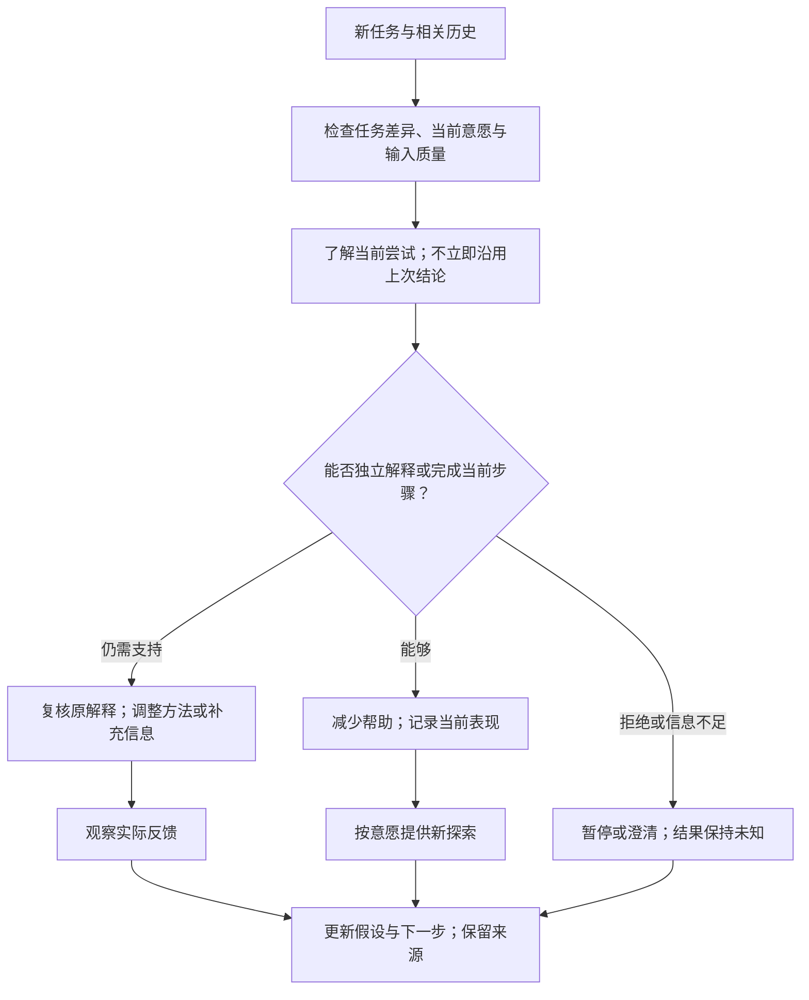

# 端到端合成样例：求助、支持、探索与复盘

> DRAFT v0.2，2026-10-17。所有人物、话语、任务、事件和结果均为合成设计材料，不描述真实儿童。没有真实论文、效应量、科研结论或批准资产。本例用于接口开发与隔离评测，不得作为可部署教育策略。实施任务见 [Issue 索引](../../roadmap/growth-support-issues.md)。

## 1. 场景与专业资产准备

场景：学习主体通过拍照求助，Harness 已将任务与请求统一处理；后续根据具体反应提供帮助、可选的小探索，并在另一次互动中复盘。

本地生产需要准备下列资产。这里列出的是资产槽位，尚无研究验收通过的内容。

| 槽位 | 生产过程需回答的问题 | 运行时用途 |
|---|---|---|
| 理解任务的观察方法 | 应了解哪些信息？哪些解释不能由一次表现推出？ | 选择澄清问题，保留竞争解释 |
| 学习支持策略 | 在什么条件下适用？证据是什么？哪些情况应调整？ | 提供有条件的帮助候选 |
| 兴趣探索方法 | 怎样提供选择、观察体验，避免强加兴趣？ | 从当前任务衔接可选探索 |
| 复盘方法 | 怎样区分短时完成、独立理解和其他情境的表现？ | 形成下一次观察与调整 |
| 互动人格 | 如何表达耐心、尊重自主选择、处理错误与拒绝？ | 保持连贯的表达与回应方式 |
| 场景评测 | 需要防止哪些越界和错误解释？ | 验证方法与人格实际被执行 |

对应资产需经过“获准材料 → 提取与评价 → 综合/推导 → 标明依据 → 校验 → 发布资格判断”。下文暂用 `demo-*` 资产运行纸面流程，不能借演示绕过这一链路。

## 2. 第一次互动：理解当前请求

合成输入：“三组各有四个物品，一共有多少个？我不知道从哪里开始。”

Harness 负责提取题目、确认是否存在图像识别歧义、确定请求者和主体、提供最小上下文。插件不访问照片；UnifiedSupportInput 示例见 [契约](contracts.md#21-合成输入示例)。

| 步骤 | 输入与操作 | 合格结果 | 不合格结果 |
|---|---|---|---|
| 接入 | 校验身份范围、Schema、用途和资产版本 | 将本次识别/输入质量与儿童表现分开 | 将 OCR 不确定的数字当儿童错误 |
| 澄清 | 先了解对题目要求的理解与已有尝试 | 下一步是一个有目的、可回应的问题 | 一开始认定注意力差、数学能力弱或缺乏动机 |
| 候选解释 | 保留“尚未理解题意”“不确定第一步”等解释 | 明确 unconfirmed 和所需观察 | 用一条用户表达生成固定心理特征 |
| 方法选择 | 根据实际回应检查可用方法与条件 | 有依据和适用条件的候选行动 | 依据相似关键词直接下结论 |

示例只记录短的可审计依据，例如“尚不清楚孩子怎样理解题目，因此先澄清”，不索取模型隐藏思维过程。

## 3. 提供支持，并协调不同专业视角

假设合成后续回应显示，孩子知道需要求总数，但不确定如何表示。系统可提出一个待验证的支持候选，例如选择“用图示帮助表示”或“先用自己的话重新描述”。本例不声称这些方法在任何年龄/场景都有已验证效果。

专业视角协作的结果应当是一项连贯行动：

- 学习视角关注对问题关系的理解，不只交出答案。
- 教练视角关注当前可尝试的一小步与清晰反馈。
- 一般心理支持视角关注孩子表达的挫折与意愿，不把情绪当作障碍标签。
- 发展视角提醒方法与任务难度需要匹配，不从群体结论推断个体能力。

运行核心检查前置条件、方法版本、允许动作和表达要求。Harness 根据能力选择语音、文字或受控 Web 活动；活动描述是目标、参数与结果结构，不是从资产中执行任意代码。

若孩子拒绝活动，正常分支是暂停、换方式或结束。不能将拒绝计为能力不足，也不能反复说服以延长互动。

## 4. 得到行动回执后再记录

示例结果：“在这次合成任务中，经过一次图示提示后，孩子能够解释如何得到总数。”

可以记录：任务情境、所需提示、孩子自己的解释、活动是否实际完成、使用的方法版本。不能记录：“她是视觉型学习者”“她已经掌握所有同类题”“这个策略已被证明有效”。

如果 Harness 只生成了活动但没有展示，SupportAttempt 的状态仍应为 proposed/not_delivered。若活动中断，Outcome 为 interrupted 或 unknown，而不是 success。

跨方法比较也不能忽视题目难度或帮助量变化；不使用一次正确答案作为潜力评分。

## 5. 衔接可选的兴趣探索

在当前问题得到适当处理后，系统可以提供少量不同方向的选择，例如“编一个类似的小故事”“画一种表示方法”“换个情境挑战”或“今天到这里”。候选活动须来自本地生产的探索方法，不能为了留下用户不断追加任务。

如果选择编故事，记录“本次选择了故事形式”，再询问具体喜欢哪里。若下次选择图示，不视为矛盾或兴趣退步；兴趣记录是可变化的观察。

潜力探索的下一步是提供适当机会、观察学习后的变化与主动意愿，而不是输出天赋等级。系统不要求家长提前填写兴趣清单；家长提供的信息只是可注明来源的补充。

## 6. 第二次互动：同一主体、不同任务中的复盘

宿主在授权范围内提供相关历史摘要，不交付完整原始日志。插件检索到的是“曾在某个任务中使用一种支持后出现某种表现”，而不是“此儿童永远需要这种支持”。

判断上次方法是否继续使用，需要参考当前目标、不同任务条件与儿童反馈。系统既可以维持原方法，也可以修改/放弃；不得把“维护历史一致性”当作坚持错误理解的理由。

## 7. 同一能力服务家长与教师

| 请求者 | 输入边界 | 合适输出 |
|---|---|---|
| 儿童 | 直接表达及本次任务 | 可理解的问题、选择与行动，不展示内部评价标签 |
| 家长 | 经宿主确认的访问权；家长转述注明来源 | 具体观察建议、可尝试支持、如何与孩子共同确认，不把转述当作儿童自述 |
| 教师 | 限定主体和可访问记录 | 与当前教学任务有关的支持建议，不能默认读取家庭私人对话 |

角色改变不会自动扩大权限。任何向家长/教师分享的成长摘要，仍由宿主的数据访问和呈现规则控制。请求者与儿童目标存在分歧时应表达分歧、澄清共同目标，不机械把成人的目标作为儿童已经同意的目标。

## 8. 从演示到真实试用缺少的证据

1. 至少一个完成权限、真实提取/评价与来源定位的科研闭环；这只能验证生产过程，不能证明全部支持方法有效。
2. 所选方法的证据范围和局限经核验，不把单篇论文外推成完整角色的人格与能力证明。
3. 真实发布资格路线与人格版本变更规则得到明确决定，并在代码和契约中落实。
4. DSH 统一入口、输出检查、身份隔离、记录持久化和模型/日志数据路径验收。
5. 合成行为评测通过后，才安排有边界、可停止的实际试用；试用结果保存在私人环境，不复制进本仓库。
