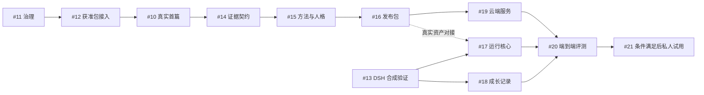

# 成长支持 MVP：Issue-first 执行索引

> 2026-10-17。产品范围已对齐，技术细节与科研发布资格按任务决策。创建开发任务不等于任务已实现或科研规则已生效。

本轮按用户授权先同步 README 与相关文档，再创建开发任务。真实首篇科研 Pilot 继续使用 [#10](https://github.com/lybym/ChildEvidence/issues/10)，不重复创建；[#2](https://github.com/lybym/ChildEvidence/issues/2) 保持原人工审核语义。历史 #1/#3 与 PR #4–#9 的完成状态不改写。

## 任务索引

2026-10-17 已创建并逐项回读核验 11 个 Issue，均为 OPEN。标题中的 P0/P1/P2 表示优先级；下表阶段 P0–P5 对应路线阶段，不代表相同含义或必须机械串行。

| Issue | 任务 | 路线阶段 | 前置与开始条件 |
|---|---|---|---|
| [#11](https://github.com/lybym/ChildEvidence/issues/11) | 明确成长支持首包资格与人格演进规则 | P0 | 可立即开始提案；规则生效需真实决定，不代签 |
| [#12](https://github.com/lybym/ChildEvidence/issues/12) | 接通获准最小包与 Harness 中立 Reviewer | P1 | #11；合成负向测试可先行，真实内容须获准 |
| [#10](https://github.com/lybym/ChildEvidence/issues/10)（既有） | Astra Research Reviewer Pilot | P1 | #12 提供接入条件；仍按原任务的权限、模型与验收要求执行 |
| [#13](https://github.com/lybym/ChildEvidence/issues/13) | 验证 DSH 原生插件、统一接口与受控输出接缝 | P3 | 可立即用隔离 profile 与合成数据开始，不依赖论文授权 |
| [#14](https://github.com/lybym/ChildEvidence/issues/14) | Evidence/Claim 与来源版本契约 | P2 | #11、#10；合成设计可先行，正式冻结需真实字段反馈 |
| [#15](https://github.com/lybym/ChildEvidence/issues/15) | 支持方法、复盘与互动人格资产 | P2 | #11、#14；包含依据性质、有限动作与评测关联 |
| [#16](https://github.com/lybym/ChildEvidence/issues/16) | 最小私有专业能力包与撤回机制 | P2 | #11、#14、#15；合成包与真实发布资格分开 |
| [#17](https://github.com/lybym/ChildEvidence/issues/17) | 成长支持运行核心与 DSH 薄适配器 | P3 | #13 后可用合成资产推进；真实资产对接依赖 #15/#16 |
| [#18](https://github.com/lybym/ChildEvidence/issues/18) | 宿主成长记录契约与隔离适配 | P3 | #13；可与 #17 并行，先用合成多主体记录 |
| [#19](https://github.com/lybym/ChildEvidence/issues/19) | 云端私有资产查询、版本与撤回服务 | P4 | #16；实际部署前决定地区、提供方、预算与凭据 |
| [#20](https://github.com/lybym/ChildEvidence/issues/20) | 专业行为基线与端到端验收 | P4 | 评测设计可先行；完整验收依赖 #17/#18/#16/#19 |
| [#21](https://github.com/lybym/ChildEvidence/issues/21) | 有边界的低风险私人使用与反馈 | P5 | #11/#10/#20/#19，以及真实资产、宿主权限和数据路径条件 |

## 建议起步顺序

1. 先推进 **#11 治理决策** 与 **#13 合成接缝验证**，两者不相互等待，也不意味着本轮自动启动实现。
2. 科研线：#12 → 既有 #10 → #14 → #15 → #16。
3. 插件线：#13 → #17 / #18；合成开发不需要把科研草稿提前发布。
4. 汇合：#16 → #19，加上 #17/#18 → #20 → 条件满足后 #21。
5. 语义检索、小模型、其他 Harness 与 LumiThink 集成属于 P6，暂不为假设需求创建实施 Issue。

图只显示主要顺序，完整前置条件以上表和各 Issue 正文为准；#11 的发布资格决定不能被其他路径跳过。

## 执行边界

科研线先完成授权与真实首篇反馈；插件线可以先使用合成数据验证 DSH 接口。真实专业资产进入用户交互前，两条线必须汇合，满足发布资格与行为验收。

所有任务均要求范围、不做事项、依赖、可验证验收与失败处理。新建 Issue 不改变现有 #10 的模型限定，不自动批准原文外发、未审核资产发布或私人试用。

设计入口：[产品](../design/growth-support-mvp/README.md)、[架构](../design/growth-support-mvp/architecture.md)、[契约](../design/growth-support-mvp/contracts.md)、[样例](../design/growth-support-mvp/walkthrough.md)、[验收路线](../design/growth-support-mvp/delivery-plan.md)、[治理衔接](../governance/GROWTH-SUPPORT-TRANSITION.md)。

## 本轮交付状态

- GitHub：#11–#21 已创建，标题、正文和 OPEN 状态逐项回读一致；每项包含范围、依赖、验收、不做事项及失败/回滚方式。
- 既有 #2/#10 未改写、未关闭。Issue 创建时文档尚未提交，正文因此采用自包含描述；随后按用户确认的“文档先行”原则，将 README 与本批设计、治理衔接及路线文档作为独立文档提交同步到仓库，不包含业务实现或原有 Skill 修改。
- 仅修改 README 与相关文档；保留原有两处 Skill 本地修改，不改变业务源码、四份规程、权限门禁、历史归档或生成快照。
- 文档检查：11 份文件、84 个本地链接及锚点、3 个 JSON 示例通过；4 个 Mermaid 图完成语法与流程静态复核（未做渲染验证），`git diff --check` 通过。
- 工程回归：当前工作树的外部临时副本中，237 项测试全部通过，离线冒烟及空合成数据库状态检查通过；测试期间原项目文件未变化。未调用科研模型、未运行真实 Docling 解析，结果不代表科研验收或发布批准。验证记录位于工作区临时区 `planning-issues-20261017`。
